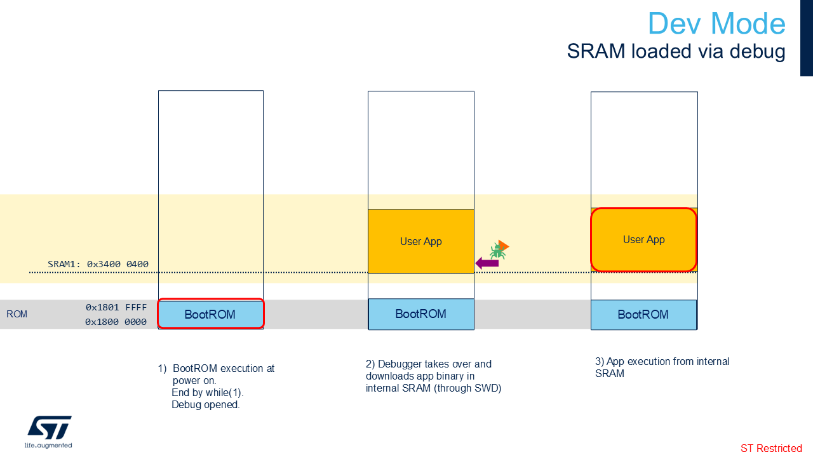
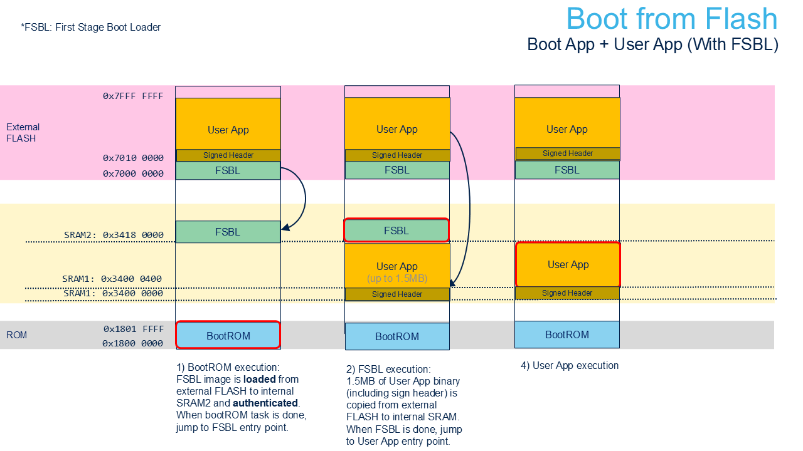

# Boot Overview

## Dev mode

## Boot from flash with First Stage Boot Loader

**Note:**
By default on the **STM32N6570-DK**, ~1MB of SRAM is reserved for the user
app (see [STM32N657XX_LRUN.ld](../Projects/GS/STM32CubeIDE/STM32N657XX_LRUN.ld))
and 1MB of SRAM2 is reserved for the network activations (see
[stm32n6.mpool](../Projects/X-CUBE-AI/models/stm32n6.mpool)).