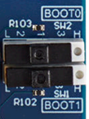
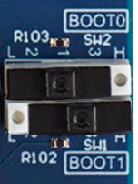

# x-cube-n6-ai-vad

This bare-metal STM32N6570-DK application runs a TEN-VAD voice-activity detector
generated with [ST Edge AI](https://www.st.com/en/development-tools/stedgeai-cubeai.html). It captures audio, extracts features, runs
inference on the NPU, and reports the results over a serial connection. See
[Build configurations](#build-configurations) for the supported model and latency
options.

## Table of Contents

- [x-cube-n6-ai-vad](#x-cube-n6-ai-vad)
  - [Table of Contents](#table-of-contents)
  - [Hardware and Software environment](#hardware-and-software-environment)
    - [Hardware support](#hardware-support)
    - [Boot modes](#boot-modes)
    - [Serial port configuration](#serial-port-configuration)
    - [Toolchains support](#toolchains-support)
  - [Build configurations](#build-configurations)
  - [Quickstart using prebuilt binaries](#quickstart-using-prebuilt-binaries)
  - [Quickstart using Source Code](#quickstart-using-source-code)
    - [Application Build and Run - Dev Mode](#application-build-and-run---dev-mode)
      - [STM32CubeIDE](#stm32cubeide)
      - [Makefile](#makefile)
    - [Application Build and Run - Boot from Flash](#application-build-and-run---boot-from-flash)
      - [Build the Application](#build-the-application)
        - [STM32CubeIDE](#stm32cubeide-1)
        - [Makefile](#makefile-1)
      - [Program the Firmware in the External Flash](#program-the-firmware-in-the-external-flash)
  - [Typical Output on uart console](#typical-output-on-uart-console)
  - [Configuration](#configuration)
  - [How to update my project with a new version of ST Edge AI](#how-to-update-my-project-with-a-new-version-of-st-edge-ai)
  - [Known issues and Limitations](#known-issues-and-limitations)

## Hardware and Software environment

### Hardware support

- MB1939 STM32N6570-DK board
  - The following OTP fuses must be set
    - VDDIO2_HSLV=1     I/O XSPIM_P1 High speed option enabled
    - VDDIO3_HSLV=1     I/O XSPIM_P2 High speed option enabled
  - *Warning*: when OTP fuses are set, they can not be reset.
  - *Warning*: when executing the project on the board, these two OTP fuses are
   set if not already

**NOTE**: on the STM32N6570-DK, the digital microphone is not connected to the ADF (Audio Digital Filter). Therefore, it cannot be used for audio capture in this project. However, the ADF can be used in final designs and enable low-power mode by filtering the audio signal before it reaches the core functions of the application, waking the CPU only when necessary.

### Boot modes

The STM32N6 series does not have internal flash memory. To retain firmware after
a reboot, program it into the external flash. Alternatively, you can load
firmware directly into SRAM (development mode), but note that the program will
be lost if the board is powered off in this mode.

Use development mode to load firmware into RAM or program external flash; use
boot-from-flash mode to run the programmed firmware.

|                  | STM32N6570-DK                                                                |
| -------------    | -------------                                                                |
| Boot from flash  |  |
| Development mode |        |


See the [Boot Overview](Doc/Boot-Overview.md) for more details.

### Serial port configuration

The application outputs results and useful information (depending on the configured
level of verbosity) through a serial connection. The default configuration of
the serial link is:

- Speed = 921600 bauds (`USE_UART_BAUDRATE` in `Projects/GS/Inc/app_config.h`)
- Data = 8 bit
- Parity = None
- Stop bit = 1 bit
- Flow control = none

### Toolchains support

- [STM32CubeIDE](https://www.st.com/content/st_com/en/products/development-tools/software-development-tools/stm32-software-development-tools/stm32-ides/stm32cubeide.html) (__v2.1.1__)
- [STM32CubeProgrammer](https://www.st.com/en/development-tools/stm32cubeprog.html) (__v2.22.0__)
- [STEdgeAI](https://www.st.com/en/development-tools/stedgeai-core.html) (__v4.1.0__)

## Build configurations

This application (a TEN-VAD voice-activity detector) has two independent
build-time axes:

| Axis | Values | Selected by |
|---|---|---|
| Quantization | `full` (fully-quantized, **default**) / `partial` (partially-quantized) | CubeIDE configuration `BM`/`BM_PQ`, or `make AI_MODEL=full\|partial` |
| Latency | low-latency `APP_LOW_LAT` (16 ms acquisition cadence, **default**) / high-latency (48 ms) | `make EXTRA_DEFS=-DAPP_LOW_LAT_OFF` (make-only; no separate CubeIDE configuration exists for this) |

Measured NPU inference time per acquisition frame, on the STM32N6570-DK:

| Model variant | Inference time (ms) |
|---|---|
| `full` | ~0.79 |
| `partial` | ~1.54 |

When running from source, flash the model weights separately from the
application. They must match its quantization variant. Use
`Projects/X-CUBE-AI/models/flash-weights.sh <full|partial>` before the first
run and whenever you switch variants. A mismatch may fail silently; check the
compiled-in variant in the boot banner.

## Quickstart using prebuilt binaries

One binary is shipped per quantization variant (both at the default low-latency
cadence — see [Build configurations](#build-configurations)):

- `Binary/STM32N6570-DK/x-cube-n6-ai-vad_full.hex` (**default**)
- `Binary/STM32N6570-DK/x-cube-n6-ai-vad_partial.hex`

Each binary includes the FSBL and matching network weights, so a single flash is
enough:

  1. Switch both switches to the right position
  2. Program `Binary/STM32N6570-DK/x-cube-n6-ai-vad_<full|partial>.hex`
  3. Switch both switches to the left position
  4. Power cycle the board

After adding your own `STM32_Programmer_CLI` to your PATH
(found in a STM32CubeIDE install at `<Installed Folder>/stm32cubeide_2.1.1/plugins/com.st.stm32cube.ide.mcu.externaltools.cubeprogrammer.<xxx version>/tools/bin/STM32_Programmer_CLI`,
or in a standalone STM32CubeProgrammer install), you can also flash with:

```bash
STM32_Programmer_CLI -c port=SWD mode=HOTPLUG ap=1 --extload <path-to-external-loader>/MX66UW1G45G_STM32N6570-DK.stldr -w Binary/STM32N6570-DK/x-cube-n6-ai-vad_<full|partial>.hex
```

After setting [Boot from flash](#boot-modes) and power cycling, you should see
the boot banner (model variant, latency mode, acquisition cadence) on the uart
console — see [Typical Output on uart console](#typical-output-on-uart-console).

## Quickstart using Source Code

The default configuration is `full` at the low-latency cadence. Before running
from source, flash the weights for the chosen variant (see
[Build configurations](#build-configurations)):

```bash
./Projects/X-CUBE-AI/models/flash-weights.sh full    # or: ./Projects/X-CUBE-AI/models/flash-weights.sh partial
```

### Application Build and Run - Dev Mode

Set your board to [development mode](#boot-modes).

#### STM32CubeIDE

Double-click `Projects/GS/STM32CubeIDE/.project` to open the project in
STM32CubeIDE. Build and run the desired configuration: `BM` (fully-quantized,
`full`, the default) or `BM_PQ` (partially-quantized, `partial`). Both build the
low-latency (`APP_LOW_LAT`) cadence; the high-latency opt-out
(`APP_LOW_LAT_OFF`) is a `make`-only option, with no separate CubeIDE
configuration.

#### Makefile

Navigate to `Projects/GS` and run the following commands (ensure required tools
are in your PATH). Only the `bm`/`bm_pq` STM32CubeIDE configurations exist for
this board, selected via `AI_MODEL` (`full` matches `bm`, `partial` matches
`bm_pq`):

1. Build the project:

  ```bash
  make AI_MODEL=full -j8      # or AI_MODEL=partial
  ```

2. Start a GDB server connected to the STM32 target:

  ```bash
  ST-LINK_gdbserver -p 61234 -l 1 -d -s -cp <path-to-stm32cubeprogramer-bin-dir> -m 1 -g
  ```

3. In a separate terminal, launch a GDB session to load the firmware:

  ```bash
    $ arm-none-eabi-gdb Build/full/x-cube-n6-ai-vad.elf
    (gdb) target remote :61234
    (gdb) monitor reset
    (gdb) load
    (gdb) continue
    ```

### Application Build and Run - Boot from Flash

Set your board to [development mode](#boot-modes).

#### Build the Application

##### STM32CubeIDE

Double-click `Projects/GS/STM32CubeIDE/.project` to open the project in STM32CubeIDE. Build and run the project.

##### Makefile

Ensure all required tools are in your PATH, then build the project with a given
AI model variant (only `full`/`partial` exist for this board):

```bash
make AI_MODEL=full -j8      # or AI_MODEL=partial
```

Optionally override the low-latency default with `EXTRA_DEFS=-DAPP_LOW_LAT_OFF`.
Output lands under `Projects/GS/Build/<AI_MODEL>/x-cube-n6-ai-vad.<elf/bin>`.

#### Program the Firmware in the External Flash

Run `sign-and-flash-app.sh <full|partial> [hl]` from
`Projects/X-CUBE-AI/models/` (`hl` selects the high-latency
`APP_LOW_LAT_OFF` build); it automates all of the steps below: it signs
`Projects/GS/Build/<variant>[_APP_LOW_LAT_OFF]/x-cube-n6-ai-vad.bin`,
combines it with the FSBL and the matching
`Projects/X-CUBE-AI/models/<variant>/network_data.hex`, and flashes the result.

To do the same steps manually, first sign the binary:

```bash
STM32_SigningTool_CLI -s -bin Projects/GS/Build/<full|partial>/x-cube-n6-ai-vad.bin -nk -t ssbl -hv 2.3 --align -o Projects/GS/Build/<full|partial>/x-cube-n6-ai-vad_signed.bin
arm-none-eabi-objcopy -I binary Projects/GS/Build/<full|partial>/x-cube-n6-ai-vad_signed.bin --change-addresses 0x70100000 -O ihex Projects/GS/Build/<full|partial>/x-cube-n6-ai-vad.hex
```

Then program the FSBL, signed application, and matching network weights:

```bash
export DKEL="$(dirname "$(command -v STM32_Programmer_CLI)")/ExternalLoader/MX66UW1G45G_STM32N6570-DK.stldr"

# First Stage Boot Loader
STM32_Programmer_CLI -c port=SWD mode=HOTPLUG ap=1 --extload $DKEL -w FSBL/ai_fsbl.hex

# Signed application
STM32_Programmer_CLI -c port=SWD mode=HOTPLUG ap=1 --extload $DKEL -w Projects/GS/Build/<full|partial>/x-cube-n6-ai-vad.hex

# Matching network weights
STM32_Programmer_CLI -c port=SWD mode=HOTPLUG ap=1 --extload $DKEL -w Projects/X-CUBE-AI/models/<full|partial>/network_data.hex
```

## Typical Output on uart console

At boot, the serial console prints the build and model configuration, including
the model variant and latency mode, followed by hardware and NPU details.
During processing, it reports per-frame CPU, preprocessing, inference, and
voice-activity statistics.

## Configuration

Edit `Projects/GS/Inc/app_config.h` to change logging (`LOG_LEVEL`), the
serial baud rate (`USE_UART_BAUDRATE`), the default latency (`APP_LOW_LAT`), or
the voice-activity threshold (`APP_VAD_THR`).

To regenerate the network sources from a `.onnx` model, see
`Projects/X-CUBE-AI/models/generate-n6-model.sh` (`stedgeai` on PATH,
env-overridable `STEDGEAI`) and
`Projects/X-CUBE-AI/models/sign-and-flash-app.sh` (see
[Program the Firmware in the External Flash](#program-the-firmware-in-the-external-flash)).
`Projects/X-CUBE-AI/models/deploy-app.sh <full|partial> [hl]` chains
regeneration, the `make` build and flashing.

## How to update my project with a new version of ST Edge AI

The neural network model files (`network.c/h`, `stai_network.c/h`, etc.) 
included in this project were generated using
[STEdgeAI](https://www.st.com/en/development-tools/stedgeai-core.html) version 4.1.0.

Using a different version of STEdgeAI to generate these model files may result
in the following compile-time error: `Possible mismatch in ll_aton library used`.

If you encounter this error, please follow the STEdgeAI instructions on 
[How to update my project with a new version of ST Edge AI Core](https://stedgeai-dc.st.com/assets/embedded-docs/stneuralart_faqs_update_version.html)
to update your project.

## Known issues and Limitations

None.